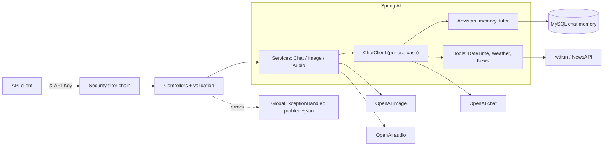
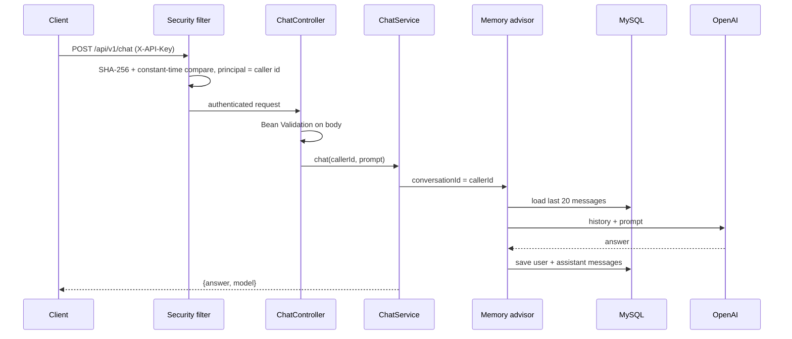

# Enterprise Spring AI Playbook

Production-minded patterns for enterprise LLM backends on **Spring AI 2.0**, **Spring Boot 4** and **Java 21**: tool calling, durable chat memory, custom advisors, multimodal (image and audio), API-key security, validated REST contracts and a test suite that runs without an API key.

> Scope: a focused reference of patterns, not a finished product. Each capability is isolated behind a service so it can be read, tested and reused on its own. What is production-grade and what is deliberately left out is listed in [Production readiness](#production-readiness).

---

## Table of contents
1. [Features](#features)
2. [Tech stack](#tech-stack)
3. [Architecture](#architecture)
4. [Request flows](#request-flows)
5. [Design decisions](#design-decisions)
6. [Project structure](#project-structure)
7. [API reference](#api-reference)
8. [Getting started](#getting-started)
9. [Configuration](#configuration)
10. [Testing](#testing)
11. [Production readiness](#production-readiness)
12. [Further reading](#further-reading)

---

## Features

| # | Capability | Spring AI concept | Endpoint |
|---|---|---|---|
| 1 | Chat with **durable per-caller memory** (MySQL, sliding window) | `MessageWindowChatMemory`, `JdbcChatMemoryRepository`, `MessageChatMemoryAdvisor` | `POST /api/v1/chat` |
| 2 | **Custom advisor** (tutor-style answers) that preserves history, roles and tools | `CallAdvisor` | `POST /api/v1/chat/tutor` |
| 3 | **Tool calling**: date/time, weather, news | `@Tool`, `@ToolParam`, `defaultTools` | `POST /api/v1/assistant/ask`, `/assistant/plan-my-day` |
| 4 | **Prompt templating** with validated variables | `PromptTemplate` via `user(u -> u.text().param())` | `GET /api/v1/recommendations/movie` |
| 5 | **Image generation**, stored server-side and downloadable | `ImageModel`, `ImagePrompt` | `POST /api/v1/images`, `GET /api/v1/images/{id}` |
| 6 | **Image understanding** (vision) | `ChatClient` + media | `POST /api/v1/images/descriptions` |
| 7 | **Speech to text, then translation** (chained model calls) | `OpenAiAudioTranscriptionModel` + `ChatClient` | `POST /api/v1/audio/transcriptions` |
| 8 | **Text to speech** | `OpenAiAudioSpeechModel` | `POST /api/v1/audio/speech` |
| 9 | Health probes | Actuator | `GET /actuator/health` |

Cross-cutting: API-key authentication, Bean Validation, RFC 9457 problem+json errors, typed configuration, graceful shutdown, virtual threads, Docker and CI.

---

## Tech stack

| Layer | Technology |
|---|---|
| Language / runtime | Java 21 (records, virtual threads) |
| Framework | Spring Boot **4.0.9**: MVC, Security, Validation, Actuator, JDBC |
| AI | Spring AI **2.0.1** (BOM-managed), OpenAI via `spring-ai-starter-model-openai` |
| Memory store | MySQL 8 (`spring-ai-starter-model-chat-memory-repository-jdbc`) |
| Outbound HTTP | `RestClient` with explicit timeouts |
| Tests | JUnit 5, Mockito, MockMvc, Spring Security Test, H2, Testcontainers (MySQL) |
| Delivery | Maven, multi-stage Dockerfile, docker-compose, GitHub Actions |

---

## Architecture

A single Spring Boot service. Business code depends on the provider-agnostic `ChatClient`, never on a vendor SDK, so changing provider is a dependency and configuration change.



| Layer | Responsibility | Package |
|---|---|---|
| Security | Authenticate by `X-API-Key`, deny by default | `security` |
| Web | HTTP binding, validation, DTOs, error contract | `web`, `web.dto`, `web.error` |
| Service | Use cases, conversation scoping, result checks | `service` |
| AI wiring | One `ChatClient` per use case, shared memory, tool HTTP clients | `config` |
| Cross-cutting AI | Prompt policy as an advisor | `advisor` |
| Capabilities | Side-effecting functions the model may call | `tools` |

---

## Request flows

### Authenticated chat with memory

The caller id is derived from the credential, so one caller cannot read another's conversation. It scopes storage and is never sent to the model.

### Tool calling
The assistant client is built with the date/time, weather and news tools. Spring AI derives each tool's JSON schema from `@Tool`/`@ToolParam`, the model requests a call, Spring AI executes it and feeds the result back until the model produces a final answer. Tools return failures as short text instead of throwing, so the model can recover and the request does not fail.

### Errors
Every failure is `application/problem+json`: validation and malformed input → 400, missing/invalid key → 401, unsupported upload → 415, provider rate limit → 429, provider rejection or empty answer → 502, provider timeout → 504, anything else → generic 500. Provider messages, hosts and credentials are logged, never returned.

---

## Design decisions

| Decision | Rationale |
|---|---|
| `ChatClient` per use case, assembled in one config class | Each endpoint gets only the advisors and tools it needs (least privilege); no wiring in controllers |
| Caller id from the API key, not a request parameter | Prevents reading or writing another caller's memory; the same shape works with JWT `sub` later |
| JDBC-backed sliding-window memory | Survives restarts, shared across instances, bounded token cost |
| Advisor edits the **system** message | Preserves roles, history, tools and options; nothing policy-related is persisted into memory |
| Tools return errors as data and validate input | A failed third party degrades the answer, not the request; user input cannot alter the outbound URL |
| API key in header only; stored as SHA-256 digests, compared in constant time | No key in URLs or logs; no timing side channel; startup fails if no key is configured |
| Typed, validated `@ConfigurationProperties` | Bad configuration fails the startup, not the first request |
| Short explicit timeouts on tool HTTP clients, virtual threads | A slow third party cannot hold a request thread for long |
| Server-generated image file names (UUID) | No client-controlled path reaches the file system |
| BOM-managed Spring AI versions | One source of truth; prevents mixed 1.x/2.x classpaths |

---

## Project structure

```
enterprise-springai-playbook
├── pom.xml  Dockerfile  docker-compose.yml  .env.example
├── .github/workflows/ci.yml
├── docs/
│   ├── BRD_Business_Requirements.md
│   └── TDD_Technical_Design.md
└── src
    ├── main/java/com/springai/explore
    │   ├── PlaybookApplication.java
    │   ├── advisor/    TutorStyleAdvisor
    │   ├── config/     AiConfig, AppProperties
    │   ├── security/   ApiKeyAuthenticationFilter, SecurityConfig
    │   ├── service/    ChatService, ImageService, AudioService, ModelResponseException
    │   ├── tools/      DateTimeTool, WeatherTool, NewsTool
    │   └── web/        controllers, UploadValidator, dto/, error/GlobalExceptionHandler
    └── test            unit, MockMvc and Testcontainers tests
```

---

## API reference

All `/api/**` endpoints require the header `X-API-Key: <key>`. Request bodies are JSON unless noted.

| Method | Path | Input | Output |
|---|---|---|---|
| POST | `/api/v1/chat` | `{"prompt": "..."}` (1-4000 chars) | `{"answer","model"}` |
| POST | `/api/v1/chat/tutor` | same | same, tutor-style |
| POST | `/api/v1/assistant/ask` | same | same, tools enabled |
| POST | `/api/v1/assistant/plan-my-day` | same | same, planner persona with tools |
| GET | `/api/v1/recommendations/movie` | `type`, `year` (4 digits), `lang` | `{"answer","model"}` |
| POST | `/api/v1/images` | `{"prompt": "..."}` | `{"id","totalTokens"}` |
| GET | `/api/v1/images/{id}` | UUID | `image/png` |
| POST | `/api/v1/images/descriptions` | multipart `prompt`, `file` (jpeg/png/webp/gif) | `{"description"}` |
| POST | `/api/v1/audio/transcriptions` | multipart `file` (mp3/wav/m4a/webm/ogg/flac), `targetLanguage` (default Telugu) | `{"transcript","translation","targetLanguage"}` |
| POST | `/api/v1/audio/speech` | `{"text": "..."}` (max 4096) | `audio/mpeg` |
| GET | `/actuator/health` | none (public) | `{"status":"UP"}` |

```bash
KEY=your-app-api-key
curl -X POST localhost:8080/api/v1/chat -H "X-API-Key: $KEY" -H "Content-Type: application/json" \
     -d '{"prompt":"My name is Asha"}'
curl -X POST localhost:8080/api/v1/chat -H "X-API-Key: $KEY" -H "Content-Type: application/json" \
     -d '{"prompt":"What is my name?"}'
```

---

## Getting started

**Prerequisites:** JDK 21, an OpenAI API key, and either MySQL 8 or Docker.

### Option A: Docker Compose
```bash
cp .env.example .env      # fill OPENAI_API_KEY, DB_PASSWORD, APP_API_KEY (and optionally NEWS_API_KEY)
docker compose up --build
```

### Option B: local
```bash
mysql -u root -p -e "CREATE DATABASE IF NOT EXISTS spring_ai_dev;"
export OPENAI_API_KEY=sk-...  DB_PASSWORD=...  APP_API_KEY=choose-a-long-random-value
./mvnw spring-boot:run                      # add -Dspring-boot.run.profiles=dev for prompt/response debug logs
```
PowerShell: `$env:OPENAI_API_KEY="sk-..."`. The app listens on `http://localhost:8080`; it **refuses to start** without `APP_API_KEY`.

**IDE run (IntelliJ):** either add `OPENAI_API_KEY`, `DB_PASSWORD`, `APP_API_KEY` as environment variables in the Run Configuration, or set the active profile to `dev`. The `dev` profile defaults the API key to `dev-local-key` and turns on prompt/response debug logs. It is for your machine only.

---

## Configuration

| Variable / property | Default | Purpose |
|---|---|---|
| `OPENAI_API_KEY` | required | Provider credential |
| `APP_API_KEY` | required | Key for caller `demo-user` (`app.security.api-keys.<caller-id>`, caller id max 36 chars) |
| `DB_URL`, `DB_USERNAME`, `DB_PASSWORD` | localhost MySQL, `root`, required | Chat-memory database |
| `NEWS_API_KEY` | empty | Enables `NewsTool`; without it the tool reports "not configured" |
| `CHAT_MEMORY_INIT_SCHEMA` | `always` | Use `never` and a migration tool in production |
| `IMAGE_OUTPUT_DIR` | `./generated` | Where generated images are stored |
| `app.chat.max-messages` | 20 | Memory window per caller |
| `app.tools.*.timeout` | 5s | Outbound tool call timeout |

---

## Testing

```bash
./mvnw verify
```

36 tests, no network and no API key required:

| Kind | What it proves |
|---|---|
| Security filter | Digest-based key match, startup fail-fast on missing/blank/oversized ids |
| Web (MockMvc, full filter chain) | 401 contract, public health only, validation 400s, upload 400/415, UUID path checks, 502 mapping, no internal leak on 500 |
| Chat service with the real `ChatClient` and memory advisor against a fake model | History replay per caller, isolation between callers, empty-response handling |
| Advisor | Tutor instruction appended; roles and history preserved |
| Tools (MockRestServiceServer) | URL encoding, key only in header, input rejection, graceful degradation |
| Persistence (Testcontainers MySQL 8.4) | Memory round-trip on a real database; skipped automatically when Docker is unavailable |

CI (`.github/workflows/ci.yml`) runs `mvn verify` (including the MySQL test) and builds the Docker image.

---

## Production readiness

| Area | Status |
|---|---|
| Authentication | API key, stateless, deny-by-default. Next: JWT/OAuth2 resource server with tenant claims, per-key rate limits |
| Input validation / error contract | Done (Bean Validation, problem+json) |
| Secrets | Environment only; fail-fast when missing |
| Outbound resilience | Timeouts and graceful degradation in tools. Next: Resilience4j retry and circuit breaker around model calls |
| Cost / latency | Bounded memory window. Next: semantic cache, token budgets, streaming (SSE) |
| Observability | Health probes, structured server-side logs. Next: Micrometer/OTel traces, token and cost metrics |
| Guardrails | Input restrictions, system-prompt separation. Next: PII masking and prompt-injection advisors |
| Schema management | Auto-init for local use. Next: Flyway migration |
| Storage | Images on local disk. Next: object storage |
| RAG | Not in this repo |

---

## Further reading
- [`docs/BRD_Business_Requirements.md`](docs/BRD_Business_Requirements.md): business context, objectives, requirements, risks, acceptance criteria, traceability
- [`docs/TDD_Technical_Design.md`](docs/TDD_Technical_Design.md): architecture, decision records, security design, API spec, testing, roadmap
