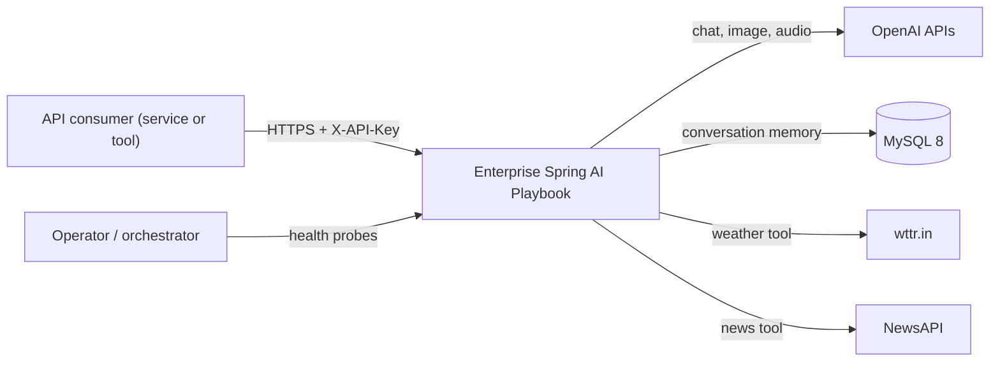
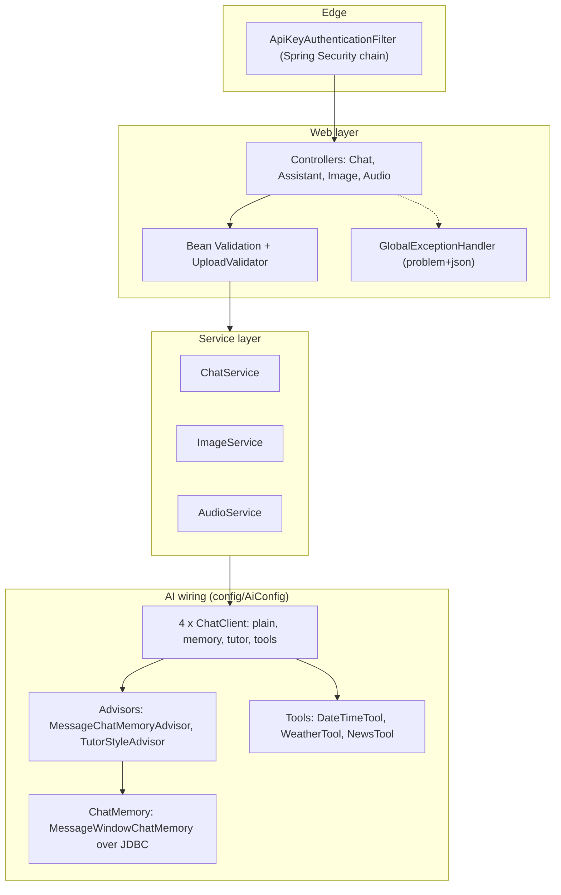
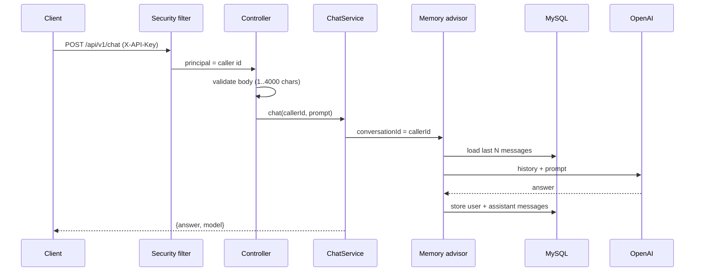

# Technical Design Document (TDD)

**System:** Enterprise Spring AI Playbook
**Version:** 1.0 · **Status:** Implemented baseline · **Last updated:** 2026-10-28
**Audience:** engineers, architects, security reviewers
**Related:** [BRD](BRD_Business_Requirements.md) · [README](../README.md)

---

## 1. Purpose and scope

This document describes how the Playbook is built: architecture, components, data, interfaces, security, error handling, testing, deployment and the decisions behind them. Requirement IDs (`BR-`, `FR-`, `NFR-`) refer to the BRD.

### 1.1 Goals
1. Expose LLM capabilities through a secure, validated, well-specified REST API (FR-01 to FR-11).
2. Keep the model provider replaceable (BR-08).
3. Make behaviour verifiable offline (NFR-08).
4. Keep the design small enough to read in one sitting, with a clear path to production hardening.

### 1.2 Non-goals
Multi-tenant administration, RAG, fine-tuning, a UI, and the roadmap items R1 to R5 (see section 15).

---

## 2. System context

---

## 3. Architecture

### 3.1 Layered view

### 3.2 Package map

| Package | Responsibility | Key classes |
|---|---|---|
| `com.springai.explore` | Entry point | `PlaybookApplication` |
| `config` | Typed settings, AI object graph | `AppProperties`, `AiConfig` |
| `security` | Authentication, filter chain | `ApiKeyAuthenticationFilter`, `SecurityConfig` |
| `web` | HTTP binding, validation, DTOs | controllers, `UploadValidator`, `dto/*` |
| `web.error` | Error contract | `GlobalExceptionHandler` |
| `service` | Use cases, result checks | `ChatService`, `ImageService`, `AudioService`, `ModelResponseException` |
| `advisor` | Cross-cutting prompt policy | `TutorStyleAdvisor` |
| `tools` | Functions the model may call | `DateTimeTool`, `WeatherTool`, `NewsTool` |

Dependencies point downward only: web → service → AI wiring → providers. Controllers contain no model logic.

---

## 4. Technology stack and versions

| Concern | Choice | Version |
|---|---|---|
| Language | Java | 21 |
| Framework | Spring Boot | 4.0.9 |
| AI framework | Spring AI (BOM-managed) | 2.0.1 |
| Provider | OpenAI via official Java SDK (inside Spring AI) | managed |
| Persistence | MySQL, `spring-boot-starter-jdbc` | 8.x |
| Security | Spring Security (stateless) | managed by Boot |
| Validation | Jakarta Bean Validation | managed |
| Tests | JUnit 5, Mockito, MockMvc, Spring Security Test, H2, Testcontainers | managed |
| Build and delivery | Maven wrapper, Docker (multi-stage), Docker Compose, GitHub Actions | n/a |

---

## 5. Architecture decision records

| ADR | Decision | Alternatives considered | Rationale and consequences |
|---|---|---|---|
| ADR-1 | Code against `ChatClient`, not the provider model | Use `OpenAiChatModel` directly | Provider swap is a dependency and configuration change; advisors, memory and tools work uniformly. Cost: a thin abstraction to learn. |
| ADR-2 | One `ChatClient` per use case, assembled in `AiConfig` | One shared client; building clients in controllers | Each endpoint gets only the advisors and tools it needs (least privilege); wiring is testable and in one place. |
| ADR-3 | Caller id from the credential becomes the conversation id | `userId` request parameter | Removes an impersonation path (reading another caller's memory). Same shape works with a JWT `sub` later. |
| ADR-4 | JDBC chat memory with a message window | In-memory; Redis; unbounded history | Survives restarts, shared across instances, bounded token cost. Redis is a later optimisation for hot sessions. |
| ADR-5 | Stateless API-key authentication | JWT/OAuth2; HTTP Basic; none | Smallest correct control for service-to-service access. Limits: no user identity, manual rotation. JWT is roadmap R1. |
| ADR-6 | Store only SHA-256 digests of keys; compare in constant time | Plain comparison of stored keys | No plaintext key in memory dumps of config; no timing side channel. |
| ADR-7 | Advisor appends to the **system** message | Rebuild the prompt as one user string | Preserves roles, history, options and tools; nothing policy-related is persisted. The first implementation flattened the conversation, a bug found and fixed during hardening. |
| ADR-8 | Tools return failures as text and validate input | Throw exceptions from tools | A failed third party degrades the answer instead of failing the request; the model can explain or retry. |
| ADR-9 | RFC 9457 `problem+json` for all errors | Ad hoc error bodies | One contract for clients; provider detail stays in logs. |
| ADR-10 | Virtual threads for request handling | Reactive stack (WebFlux) | Blocking SDK and JDBC calls stay simple and scale on I/O; no reactive rewrite. |
| ADR-11 | Typed, validated `@ConfigurationProperties` | Scattered `@Value` | Bad configuration fails startup, not the first request. |
| ADR-12 | Test on a fake `ChatModel` with the real `ChatClient` and advisors | Mock the whole client; call the real API | Exercises real memory and advisor behaviour offline and deterministically. |

---

## 6. Component design

### 6.1 Security

**Filter chain** (`SecurityConfig`): stateless; CSRF disabled (no cookie session, header auth only); HTTP Basic, form login and logout disabled; deny by default; public: `/actuator/health`, `/actuator/health/**`, `/actuator/info`. Spring Boot's default generated user is excluded (`UserDetailsServiceAutoConfiguration`) because it is unused.

**`ApiKeyAuthenticationFilter`**
1. Read header `X-API-Key`. Missing or blank: continue unauthenticated (the chain then returns 401).
2. Hash the presented key with SHA-256 and compare to every stored digest with `MessageDigest.isEqual`, with no early exit.
3. On a match, set an authenticated principal whose name is the caller id.

**Fail-fast configuration:** startup aborts if no keys are configured, a key is blank, or a caller id is longer than 36 characters (the memory table column width).

**401 body:** fixed `application/problem+json`.

**Threat model (condensed)**

| Threat | Control | Residual |
|---|---|---|
| Anonymous use of paid APIs | Deny by default, key required | Key theft: rotate, add JWT (R1) |
| Reading another caller's chat | Conversation id from credential | None known |
| Key leakage | Header only, hashed in memory, env-only configuration, not logged | Operator error |
| Timing attack on key check | Constant-time digest compare | Low |
| Prompt injection | Instructions and user text separated; tool output marked as data; free-text parameters pattern-restricted | Medium until guardrail advisors (R3) |
| Request manipulation via tool inputs | URI-variable encoding, input patterns, key in header | Low |
| Path traversal on image download | Server-generated UUID file names; UUID path variable | None known |
| Oversized or hostile uploads | 20 MB limit, empty and type checks before any paid call | Declared content type is client-supplied |
| Information disclosure in errors | Generic client messages, detail in logs only | Logs need access control |
| Secrets in source | Environment variables, `.env` ignored, example file with blanks | Rotate any previously exposed values |

### 6.2 Chat and memory

`AiConfig` builds one `ChatMemory` (`MessageWindowChatMemory`, window `app.chat.max-messages`, default 20) over the JDBC repository, and four clients:

| Client | System prompt | Advisors | Tools |
|---|---|---|---|
| `plainChatClient` | none | none | none |
| `memoryChatClient` | friendly concise assistant | memory | none |
| `tutorChatClient` | same | memory, `TutorStyleAdvisor` | none |
| `toolsChatClient` | tool-using assistant, tool output is data | memory | date and time, weather, news |

`ChatService` sets `ChatMemory.CONVERSATION_ID` from the caller id on each call and converts the provider response to a `ChatReply(answer, model)`; an empty result raises `ModelResponseException` (mapped to 502).

### 6.3 Tool calling

Tools are Spring components with `@Tool` and `@ToolParam`; Spring AI generates each JSON schema, executes the call the model requests and returns the result to the model.

| Tool | Behaviour | Safeguards |
|---|---|---|
| `getCurrentDateTime` | Current time from an injected `Clock` | Testable clock |
| `getCurrentDateTimeZone` | Time in an IANA zone | Invalid zone returns text, no exception |
| `getCurrentWeather` | `GET wttr.in/{location}?format=3` | Location pattern `[\p{L}\p{N} ,.'-]{1,80}`; URI-variable encoding; 5 s timeout; failure text |
| `getLatestNews` | NewsAPI `everything` search | Key in `X-Api-Key` header; query encoded; `pageSize` bounded; result capped at 6000 chars; "not configured" without a key; 5 s timeout |

Spring AI requires unique tool names, hence the separate zone method name.

### 6.4 Advisor

`TutorStyleAdvisor` implements `CallAdvisor`: it appends one instruction to the system message through `Prompt.augmentSystemMessage(Function)` and calls the next advisor. Note: the `String` overload **replaces** the system text, which a unit test caught.

### 6.5 Image service

| Operation | Behaviour |
|---|---|
| Generate | `ImageModel.call` with 1024x1024, quality high; decode base64; write `{uuid}.png` under `app.image.output-dir`; return `ImageResult(id, totalTokens)`. `totalTokens` is `null` when the provider reports none or zero. |
| Download | `GET /api/v1/images/{id}` where `id` is a UUID; 404 if absent |
| Describe | Uploaded image sent as media in a vision prompt; content type validated first |

### 6.6 Audio service

| Operation | Behaviour |
|---|---|
| Transcribe and translate | Upload to the transcription model, then a translator `ChatClient`. The translation instruction is the system message; the transcript is the user message, so audio content cannot rewrite the instructions. Target language is pattern-restricted (default Telugu). |
| Speak | `OpenAiAudioSpeechModel` with voice FABLE and speed 1.5; returns `audio/mpeg` bytes; text limited to 4096 characters. |

---

## 7. Data design

Chat memory is stored by Spring AI's JDBC repository: one row per message, keyed by `conversation_id` (`VARCHAR(36)`), with message content, type and timestamp. The application owns no other tables. Images are files on disk, named by UUID.

| Concern | Current | Planned |
|---|---|---|
| Schema creation | `initialize-schema=always` (local convenience; configurable by `CHAT_MEMORY_INIT_SCHEMA`) | Flyway migration with `never` (R5) |
| Retention | None | Per-caller retention and deletion API |
| Image storage | Local directory, volume in Compose | Object storage with signed URLs (R5) |

---

## 8. API specification

All `/api/**` endpoints require `X-API-Key`. JSON unless noted. Prompt limit 4000 characters.

| Method | Path | Request | Success | Errors |
|---|---|---|---|---|
| POST | `/api/v1/chat` | `{"prompt"}` | 200 `{"answer","model"}` | 400, 401, 429, 502, 504 |
| POST | `/api/v1/chat/tutor` | same | same | same |
| POST | `/api/v1/assistant/ask` | same | same | same |
| POST | `/api/v1/assistant/plan-my-day` | same | same | same |
| GET | `/api/v1/recommendations/movie` | `type`, `year` (4 digits), `lang` | 200 `{"answer","model"}` | 400, 401, 502 |
| POST | `/api/v1/images` | `{"prompt"}` | 200 `{"id","totalTokens"}` | 400, 401, 502, 504 |
| GET | `/api/v1/images/{id}` | UUID | 200 `image/png` | 400, 401, 404 |
| POST | `/api/v1/images/descriptions` | multipart `prompt`, `file` | 200 `{"description"}` | 400, 401, 415, 502 |
| POST | `/api/v1/audio/transcriptions` | multipart `file`, `targetLanguage` | 200 `{"transcript","translation","targetLanguage"}` | 400, 401, 415, 502 |
| POST | `/api/v1/audio/speech` | `{"text"}` (max 4096) | 200 `audio/mpeg` | 400, 401, 502 |
| GET | `/actuator/health` | none | 200 `{"status":"UP"}` | n/a |

### Error model

| Status | Cause |
|---|---|
| 400 | Validation failure, malformed JSON, missing parameter, bad UUID, empty upload |
| 401 | Missing or invalid API key |
| 404 | Unknown image id |
| 415 | Unsupported upload content type |
| 429 | Provider rate limit |
| 502 | Provider rejected the request, or returned nothing usable |
| 504 | Provider unreachable or timed out |
| 500 | Anything else; generic text, details logged |

Body shape (RFC 9457): `{"type","title","status","detail","instance"}`.

---

## 9. Configuration

| Key | Default | Notes |
|---|---|---|
| `OPENAI_API_KEY` | required | Provider credential |
| `APP_API_KEY` | required | Key for caller `demo-user` (`app.security.api-keys.<id>`) |
| `DB_URL`, `DB_USERNAME`, `DB_PASSWORD` | local MySQL, `root`, required | Memory store |
| `NEWS_API_KEY` | empty | Enables the news tool |
| `CHAT_MEMORY_INIT_SCHEMA` | `always` | Use `never` in production |
| `IMAGE_OUTPUT_DIR` | `./generated` | Image storage path |
| `app.chat.max-messages` | 20 | Window size (1 to 200) |
| `app.tools.*.timeout` | 5 s | Outbound tool timeout |
| `spring.threads.virtual.enabled` | true | Virtual threads |
| `server.shutdown` | graceful, 30 s | Drain on stop |
| Actuator exposure | `health`, `info` | Details hidden, probes on |

Profile `dev` turns on prompt and response DEBUG logging and defaults the API key to a public value; it is for a developer machine only.

---

## 10. Deployment

| Artifact | Detail |
|---|---|
| Image | Multi-stage `Dockerfile`: Maven build on JDK 21, runtime on JRE 21, non-root user, `MaxRAMPercentage=75`, exits on out-of-memory |
| Local stack | `docker-compose.yml`: MySQL 8.4 with health check, app waits for a healthy database; secrets from a git-ignored `.env` (template in `.env.example`) |
| CI | GitHub Actions: JDK 21, `mvn verify` (includes the MySQL Testcontainers test), then a Docker image build |
| Probes | Liveness and readiness via `/actuator/health` |

Status: Dockerfile, Compose and CI are written and reviewed but have not yet been run end to end.

---

## 11. Testing strategy

Pyramid with no network or paid key required.

| Level | Classes | Tests | Proves |
|---|---|---|---|
| Unit | `ApiKeyAuthenticationFilterTests`, `TutorStyleAdvisorTests`, `DateTimeToolTests`, `WeatherToolTests`, `NewsToolTests` | 17 | Key matching and fail-fast, prompt shape, tool encoding, header-only key, graceful degradation |
| Component (real `ChatClient` and advisors, fake model) | `ChatServiceMemoryTests` | 3 | History replay, per-caller isolation, empty-response handling |
| Web (MockMvc through the real filter chain, AI services mocked) | `ApiWebTests` | 14 | 401 contract, public health only, validation, upload 400/415, UUID check, 502 mapping, no leakage on 500 |
| Context | `ApplicationContextTests` | 1 | Application starts with JDBC memory on H2 |
| Integration | `MysqlChatMemoryIntegrationTests` | 1 | Round trip on real MySQL 8.4 via Testcontainers; skipped when Docker is unavailable |

Total 36 tests: 35 run anywhere, 1 needs Docker. **Gaps:** no LLM evaluation suite (golden prompts), no load test, no contract tests against live providers. Real-model behaviour was verified manually against OpenAI.

---

## 12. Observability

| Capability | Status |
|---|---|
| Health, liveness, readiness | Done |
| Structured server logs with provider error detail (never returned to clients) | Done |
| Prompt and response debug logging | `dev` profile only |
| Metrics (latency, tokens, cost per caller), distributed tracing, JSON logs, dashboards | Planned (R4) |

---

## 13. Performance and scalability

- **Concurrency:** virtual threads keep blocking calls cheap; no reactive code.
- **Statelessness:** all conversation state is in MySQL, so instances scale horizontally; no sticky sessions.
- **Bounded work:** 20-message window, 4000-character prompts, 20 MB uploads, 6000-character news results, 5 s tool timeouts.
- **Dominant latency** is the model call. Indicative single local timings: chat 3.5 s, tools 9.3 s, TTS 1.9 s, transcription plus translation 22 s, image 32 s.
- **Not done:** load testing, connection-pool tuning, semantic cache, streaming.

---

## 14. Known limitations and technical debt

| # | Item | Impact | Plan |
|---|---|---|---|
| 1 | Static API keys, no rotation or rate limiting | Medium | R1 |
| 2 | No retry or circuit breaker on model calls | Medium | R2 |
| 3 | No PII or injection guardrail advisors | Medium | R3 |
| 4 | No metrics or tracing; no token or cost accounting | Medium | R4 |
| 5 | Schema auto-created; images on local disk | Low | R5 |
| 6 | Declared upload type only, no content sniffing | Low | Backlog |
| 7 | Caller id limited to 36 characters by the memory table | Low | Documented constraint |
| 8 | Container and CI pipeline not yet run end to end | Low | First push |

---

## 15. Roadmap

| Phase | Deliverable |
|---|---|
| R1 | JWT/OAuth2 resource server with tenant claims; per-key rate limits; rotation |
| R2 | Resilience4j timeouts, retries, circuit breaker and fallbacks around model calls |
| R3 | PII-masking and injection-guard advisors; audit ledger |
| R4 | Micrometer and OpenTelemetry; token and cost metrics; semantic cache; SSE streaming |
| R5 | Flyway; object storage; load test with published results; evaluation suite for model changes |

---

## 16. Appendix: how the pieces were verified

| Claim | Evidence |
|---|---|
| Security, validation and error contract | `ApiWebTests` (14), live run with a bad provider key (clean 502) |
| Memory isolation | `ChatServiceMemoryTests`; MySQL round trip test |
| Tools | Unit tests plus a live multi-tool answer (Tokyo time and Hyderabad weather) |
| Multimodal | Live runs: transcription with translation, image generation and download, text to speech |
